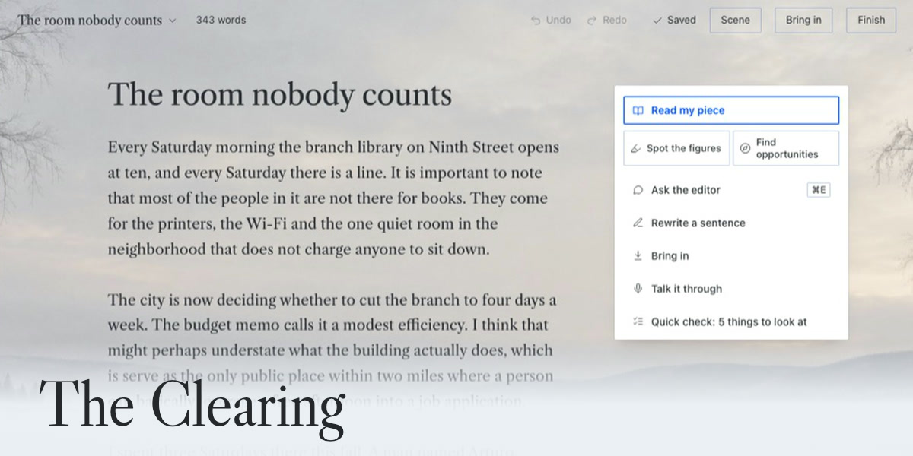
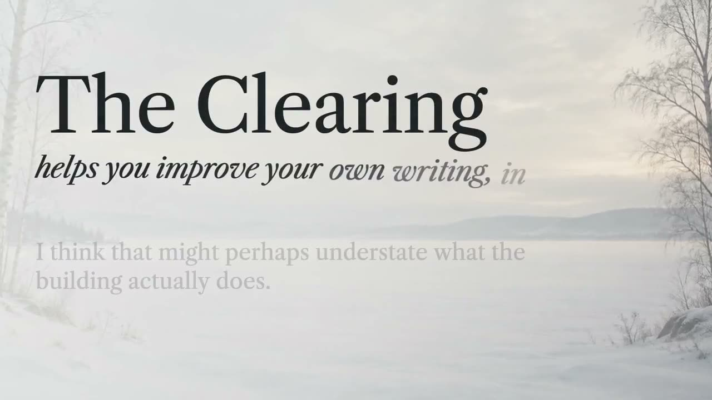
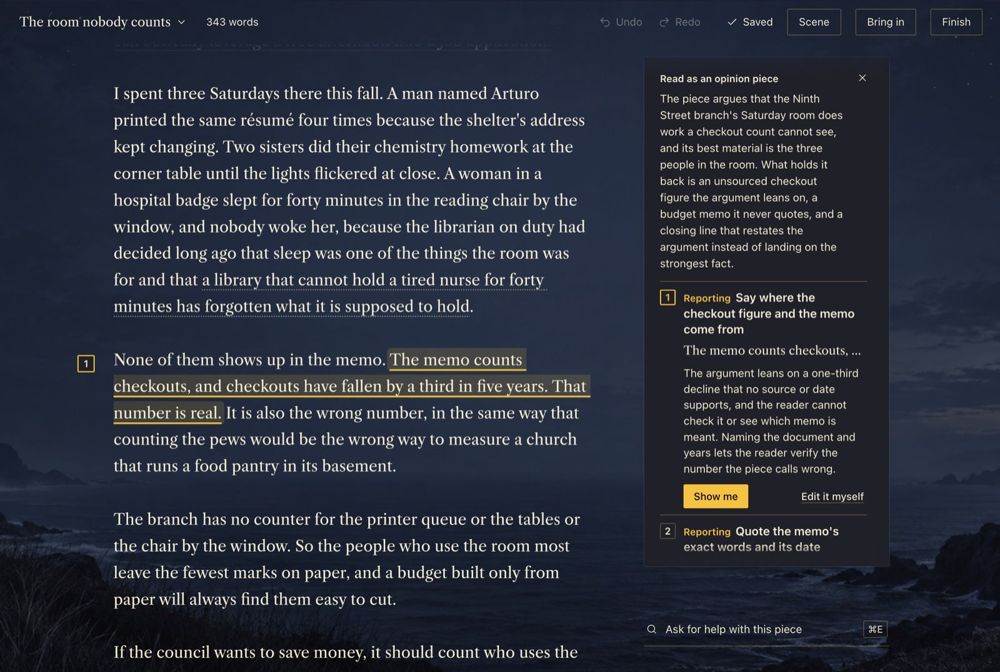
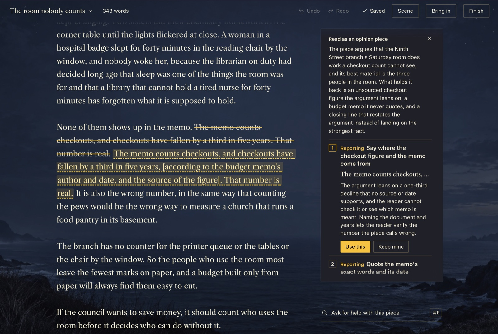
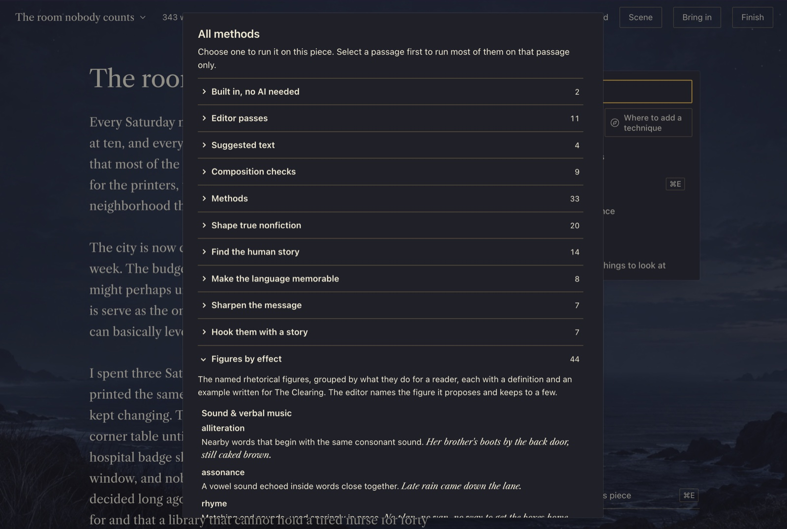
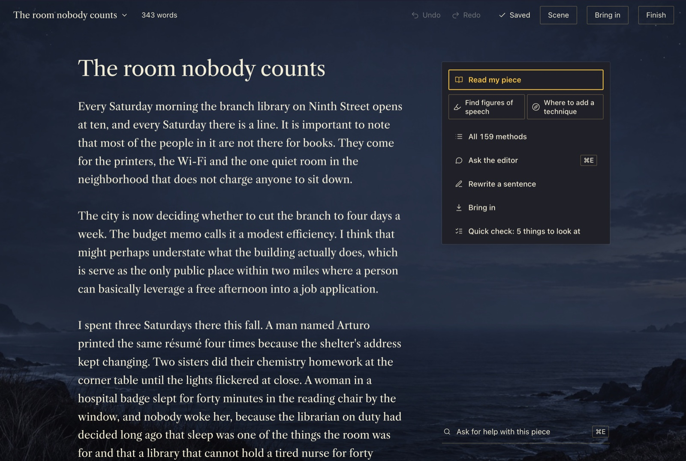

# The Clearing for Hermes



[](https://linchpin.studio/hermes/video/clearing.mp4)

**[Watch the 30-second demo](https://linchpin.studio/hermes/video/clearing.mp4)** · [Manual](https://linchpin.studio/hermes/clearing/manual/) · [All four plugins](https://linchpin.studio/hermes/)

The Clearing is a writing editor inside Hermes Agent. Paste a draft and press **Read my piece**: it marks your own sentences with what to change, most important first, and changes nothing until you press **Use this**. Run any of 159 editing methods by name, from Strunk's composition rules to 44 figures of speech. Three reviewers can read it separately and argue it out. Your pieces are saved on your computer.

You write on one page, over a scene that follows your Hermes theme (Snow Light, Quiet Marsh, Night Tide, a plain page, or a picture of your own). The editor's suggested words are marked in the page, so you can always tell whose words are whose. Every note sits beside the words it is about and names one change and why. **Show me** draws the change into your page: your words struck through, the editor's version after. **Use this** keeps it, **Keep mine** leaves your words, and **Undo** takes a kept change back out.

## What it looks like









## Requirements

- Hermes Desktop 0.21.6 or newer.
- A model set up in Hermes, for everything the editor does. If you have chatted with Hermes, you have one. If not, open Hermes Settings, Model, and pick a provider and model. Quick check, Other words, Bring in (except a link and dictation), History, Trash and Finish work without one.
- Tested on a Mac. Windows and Linux have not been tested yet.

## Install

From the Hermes plugin catalog: open Capabilities, then Plugins, search for The Clearing and click Install. Or in a terminal:

```
hermes plugins install clearing
```

To install from this repository instead: `hermes plugins install Dgardenhire/hermes-clearing`, or Capabilities, Plugins, Install from Git with `https://github.com/Dgardenhire/hermes-clearing`. Turn it on in Capabilities, Plugins. The Clearing appears in the sidebar and opens a sample piece with a welcome card the first time.

Optional: in Settings, Model, Auxiliary models, set **The Clearing editor** to the model you want the editor to use, such as a faster or cheaper one than you chat with. Without a choice it uses your main model.

## Uninstall

Open Capabilities, then Plugins, and turn The Clearing off, or click **Uninstall** beside it. In a terminal: `hermes plugins remove clearing`.

Removing the plugin keeps your writing in `<HERMES_HOME>/plugin-data/clearing/`, so reinstalling picks up where you left off. To erase everything, delete that folder after removing the plugin. Files you exported to your own folders stay where you saved them.

## What it does

- **Read my piece.** The editor reads the whole piece and returns up to five changes, most important first, with your strongest line, a question to answer before you publish when there is one, and the one passage it would cut first. A piece over 1,500 words is read in sections. **Find figures of speech** marks the figures of speech you already use, from the library's 44, and changes nothing. **Where to add a technique** lists up to eight places where one item from the library would lift the piece. Both can be tried in your own words with **Try it**, where the coach asks questions and writes nothing.
- **One sentence at a time.** Select a sentence or paragraph and a bar offers **Rewrite** (three versions), **Tighten**, **Make it concrete** and **Ask**. Select a single word and it offers **Other words**.
- **Quick check, no AI needed.** Throat-clearing, stock openings, stacked hedges, filler, stock phrases, "not X, it's Y" setups and long sentences, marked in the page. Words inside quotation marks are left alone.
- **Other words, no AI needed.** Double-click a word: its senses and other words for it open in a card beside it, from Open English WordNet. Click one and it swaps in; your word and every word you tried stay in the card. **Suggest wording** asks your model for four more.
- **The Ask line** (Cmd E on a Mac, Ctrl E elsewhere). Say what you want in plain words ("my ending is weak", "where do readers get lost", "spelling") and it finds the matching method, or sends your words to the editor as typed. With a passage selected you get three versions of it.
- **Notes tied to your words.** Every note quotes your piece. If the quoted words are not really in your piece, the note is dropped. If you rewrite a passage while the editor works, its note is set aside.
- **Bring in** a Word file, a PDF, a text or Markdown file, a public web page, pasted text, or your voice (**Talk it through**, which types at the cursor). Word files and PDFs come in as words only.
- **Undo, History and Finish.** Undo and Redo sit in the top line. History lists every saved version of the piece and the suggested text you used, with the model that wrote each. **Finish** copies as Markdown or plain text, saves a .md or .txt file into a folder you choose, saves as Word, and marks a version finished.
- **Pieces.** Your piece saves itself as you pause, and keeps a version after two idle minutes, before a change you keep and at Finish. Move a piece to the Trash and restore it, or delete it forever there (it asks first). Mark pieces you wrote as voice samples, and keep rules in **Your guidance** that go to the editor on every pass.
- **The room.** Scene, Text (Regular or Larger), Contrast (Standard or Stronger) and **Suggested text** (Shown or Off). With Suggested text Off the editor points and asks but writes no words for you.

## The library

Find any method from the Ask line, or open **All methods** on the desk, right under Read my piece.

| | Items |
|---|---|
| Built in, no AI needed: Quick check and Other words | 2 |
| Editor passes: Fix punctuation and typos, Find weak sentences, Find sentences that run long, Find tangled sentences, Find words that feel out of place, Find hedges and filler, Propose openings, Three ways to state the main point, Three ways to make the promise, Try a shorter draft, Suggest wording | 11 |
| Suggested text: Rewrite, Suggest a next sentence, Propose endings, Title ideas | 4 |
| Composition checks after Strunk, such as one job per paragraph and weight at the end | 9 |
| Editorial methods, such as Find the main point, See where readers get lost, Anticipate counterarguments and Build earned tension | 33 |
| Craft techniques in five paths: Shape true nonfiction, Find the human story, Make the language memorable, Sharpen the message, Hook them with a story | 56 |
| Figures of speech by effect, in six groups, each with a definition and an example | 44 |

With Suggested text Off, the nine methods that write words for you leave the list.

Most methods return notes on your words. Eight have their own screen: **Turn material into a draft** (three drafts from your notes, with anything the notes lack listed apart), **Check whether it sounds like you** (against your voice samples, quoting the sample each judgment rests on), **Get several editorial perspectives** (a newcomer, a skeptic and a line editor, each reading on their own), **Let reviewers argue it through**, **Keep a lesson for next time**, **Build your writing guidance**, **Set up a writing home** (your guidance and pieces as a folder of plain files, no AI needed) and **Find the piece across drafts**.

## Where your words go

Your pieces, versions and notes are saved on your computer, in `<HERMES_HOME>/plugin-data/clearing/`.

When you ask the editor for anything, the piece (or the passage you selected), its title and the rules in Your guidance go to the model you chose in Hermes. Hermes removes keys and passwords from the text first, and The Clearing sends nothing if that step is unavailable. A model on your own computer keeps the text there; a cloud model sends it to that provider. The voice check, Build your writing guidance and Suggest a next sentence also send the pieces you marked as voice samples. Find the piece across drafts sends the pieces you choose.

Quick check, Other words, reading Word files and PDFs, your scene picture, the writing home and your history stay on your computer.

## Disclosures

- **Internet.** The Clearing reaches the internet only through Hermes, and only when you start something. Editor passes go to your model. **Bring in a link** asks Hermes's web tool to fetch the page, after The Clearing checks that the address is a public web address. **Talk it through** sends your recording to the speech-to-text set up in Hermes. If that is a cloud service, The Clearing names the service and waits until you press Send. Credit links on the About screen open in your browser when you click one.
- **Files outside its own folder.** Only the files you pick, plus two things it reads and never changes: Hermes's speech-to-text setting, and a speech model already downloaded to your computer's shared Hugging Face folder. It uses that model only when Hermes's speech-to-text is unavailable, and never downloads one.
- **Microphone.** On only after you click the microphone or Talk it through, and off when you click again or after ten minutes. The recording is deleted once it has been turned into text. Neither the audio nor a transcript is kept.
- **Programs and background work.** It runs no other programs, schedules nothing and never updates itself. While a pass you started is running, the page checks about once a second whether it has finished.
- **Keys and tracking.** It stores no keys or passwords and sends no usage data.
- **What it saves.** Pieces, versions, editor notes, your rules, the suggestions you kept or skipped, and for each pass the model name and how many tokens it used. When a pass fails, one line goes to `debug.log` in the same folder: the time and the kind of error, never your words. It keeps the last 200 lines.
- **Deleting.** Move to trash can be undone. In the Trash, **Delete forever** and **Empty the trash** ask first, then erase the piece, its versions and its notes, with the words overwritten in the database. Rules you kept from that piece stay in Your guidance. Files you exported and a writing home you set up are left alone.

## Credits

The Clearing applies 159 methods and techniques drawn from timeless editing and craft practice.

The Clearing is an independent plugin by Damon Gardenhire, not an official Nous Research plugin.

## For developers

- Tests: `/usr/bin/python3 -m unittest discover -s tests` from this folder (the page's JavaScript tests run through `node --test` when node is installed).
- Desktop bundle: `node <hermes-ui-kit>/scripts/build.mjs .` with a checkout of hermes-ui-kit.
- The plugin registers one model setting (`clearing_editor`) and one observe-only `post_auxiliary_call` hook, which reads only the finish reason, model name and token counts of its own calls, never prompt or reply text.
- `dictation.py` imports `tools.voice_mode.transcribe_recording`, which is not in Hermes's public plugin API. The import is guarded: if it fails, dictation falls back to a local faster-whisper model when one is already downloaded, and on that path sets `KMP_DUPLICATE_LIB_OK=TRUE` in the process.
- What changed: [CHANGELOG](CHANGELOG.md). Manual source: [docs/MANUAL.md](docs/MANUAL.md).

## License

Free to use, including for paid writing work. You may not use this code to offer a competing product. [PolyForm Shield License 1.0.0](LICENSE), Copyright (c) 2026 Damon Gardenhire. Fonts, the WordNet data and other third-party material keep their own licenses, listed in [NOTICE](NOTICE).
