# The Clearing for Hermes

A writing room for Hermes Desktop. Your Hermes model reads your piece and suggests changes in the page, and you choose which ones to use.

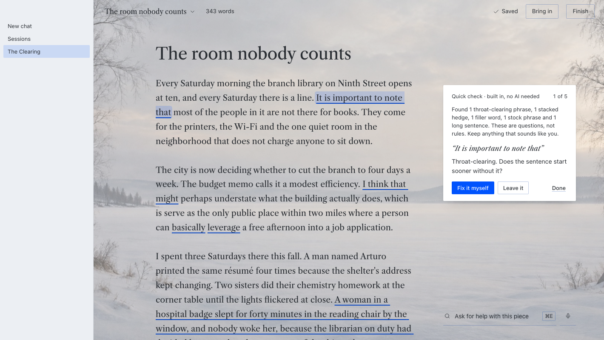

You write in one quiet page, set in Libre Caslon Text, inside a scene that follows your Hermes theme: a winter lake or a misty marsh by day, a night shore in dark mode, or a plain page, with larger text and stronger contrast a click away. When you want a second pair of eyes, the editor gives you one note at a time, each pinned to the exact words it is about.

## What it does

- **Quick check, built in, no AI needed.** Throat-clearing, stock openings, stacked hedges, filler, stock phrases, "not X, it's Y" setups and long sentences, marked in the page without a model call. Words inside quotation marks are left alone, since a quote isn't yours to edit, and sentences split the way a reader splits them ("Dr. Okafor", "1:52 a.m., with").
- **Other words, built in, no AI needed.** Double-click a word (or Cmd Shift E with the cursor in it): its senses and other words for it open in a small card beside the word, from Open English WordNet. Click one and it swaps into the page; your word and every word you tried stays in the card. It works without your model. Suggest wording asks your model for four other ways to say a word or phrase, in the same card.
- **An editor that proposes changes.** Every note names one change to the words it quotes and why, usually with a **Try**: those words rewritten in your register. **Show me** puts it into your sentence for you to use or not. Praise is held to a line; a note that only praises is dropped.
- **Suggested text.** Rewrite a selected passage three ways, get a next sentence when you're stuck, propose endings and titles. A suggestion goes into the page when you click Use this, suggestions that bring in stock phrases are screened out first, History lists every suggestion you used and which model wrote it, and **Suggested text: Off** in The room makes it a room with no AI-written words.
- **Bring in** anything: a Word file, a PDF, a text or Markdown file, a public web page (through your Hermes web tool), dictation (through your Hermes speech-to-text), or pasted text.
- **The Ask line** (Cmd E on a Mac, Ctrl E elsewhere). Say what you want help with in plain words ("my ending is weak", "where do readers get lost", "spelling", "nut graf", "subtext", "the middle sags") and it finds the right pass in the library, then runs it on your own Hermes model.
- **Notes pinned to your words.** Every quote the model returns is checked against your text before you see it. A note that doesn't match is dropped and counted, never guessed at. If you rewrite a passage while the editor works, its note is set aside, not misapplied.
- **Change records.** Corrections arrive as change records you keep or skip one by one, then apply. Proposed openings preview in the page, in the editor's typeface, with yours one click away. Try a shorter draft strikes through what the piece could lose, in place; click any passage to keep it, then accept the rest.
- **Pieces and versions.** Autosave on every pause, a version every two idle minutes, before every change you keep from the editor and on Finish. Restore any version. Move a piece to the trash and restore it.
- **Word files and PDFs.** Open a .docx draft or a PDF (its words come in; comments, images and formatting stay in the original) and save any piece as a .docx through Hermes's save dialog.
- **Finish.** Copy as Markdown or plain text, save a .md or .txt file into a folder you choose, save as Word, and mark the version finished.

## Screens

| Light | Dark |
|---|---|
|  | 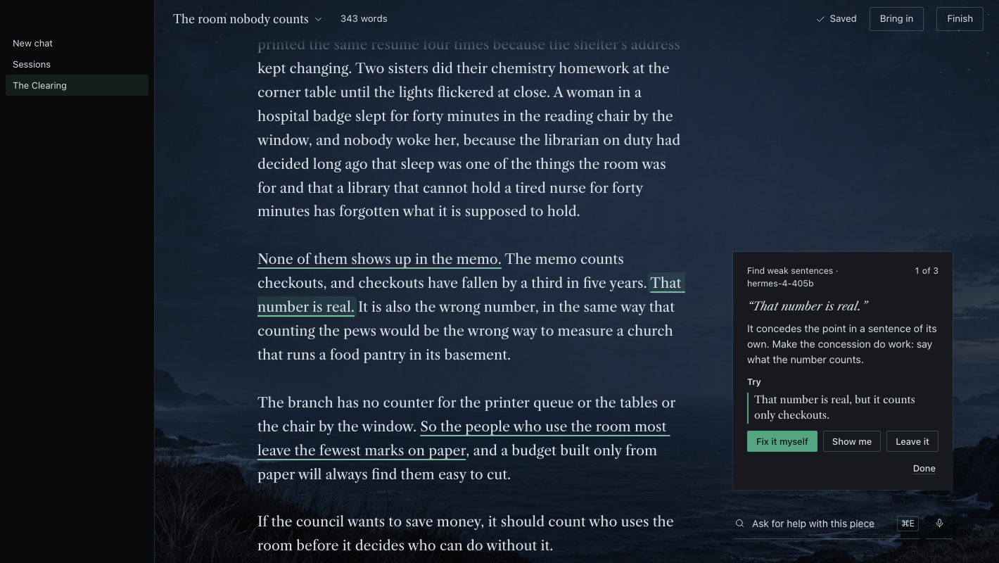 |
| 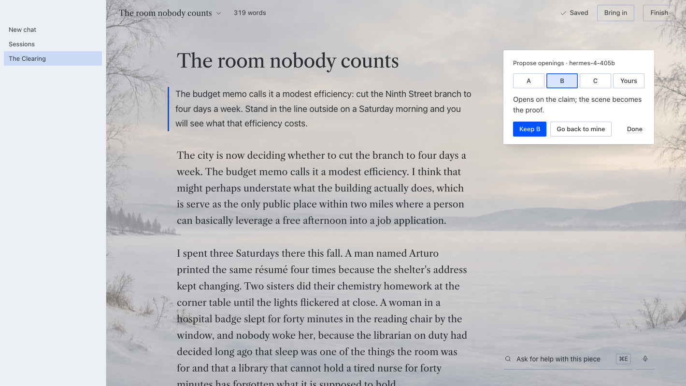 | 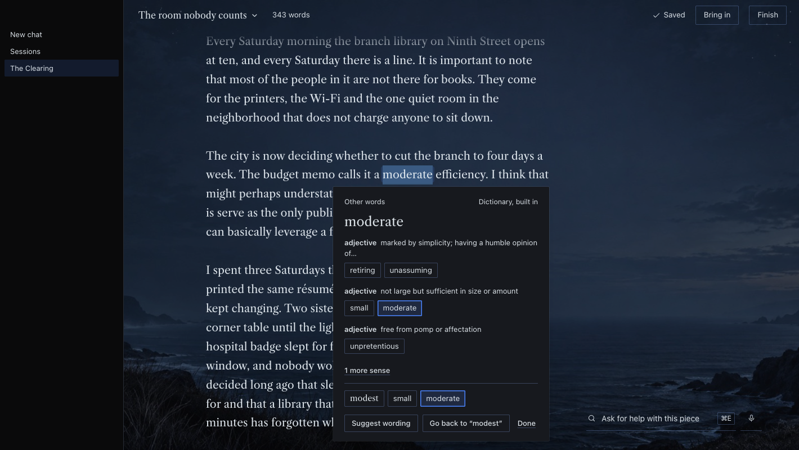 |
| 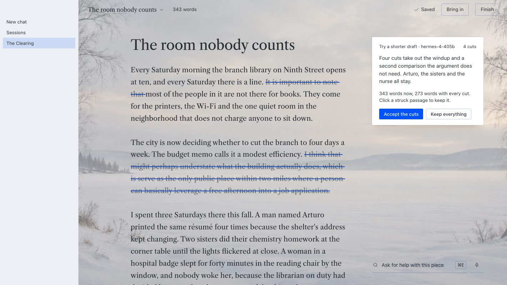 | 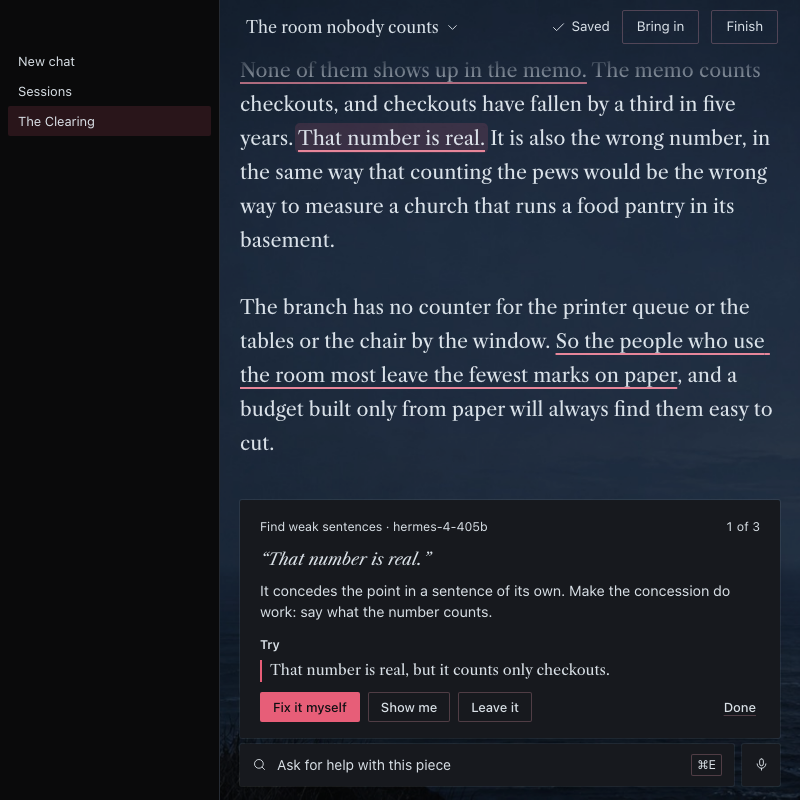 |
| 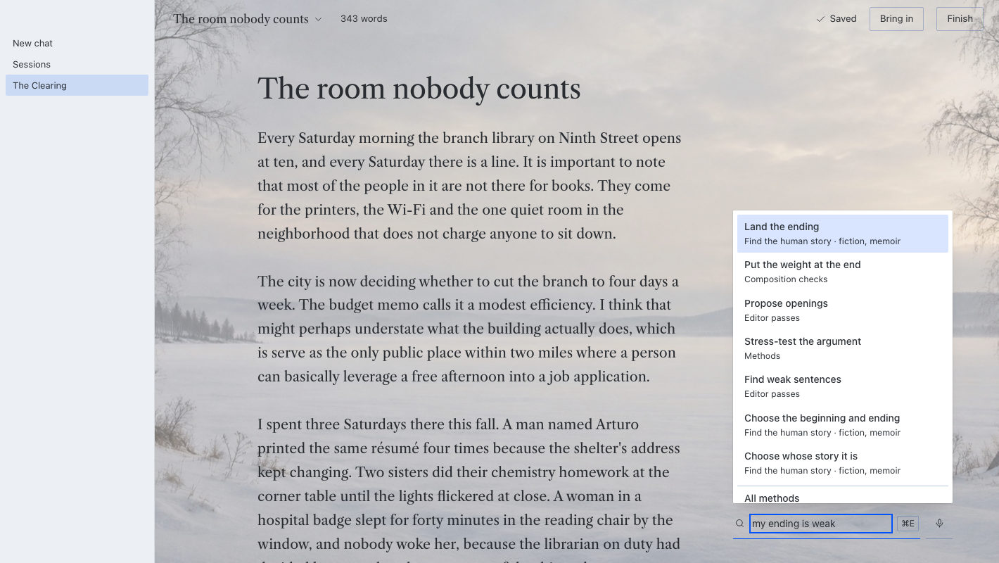 | 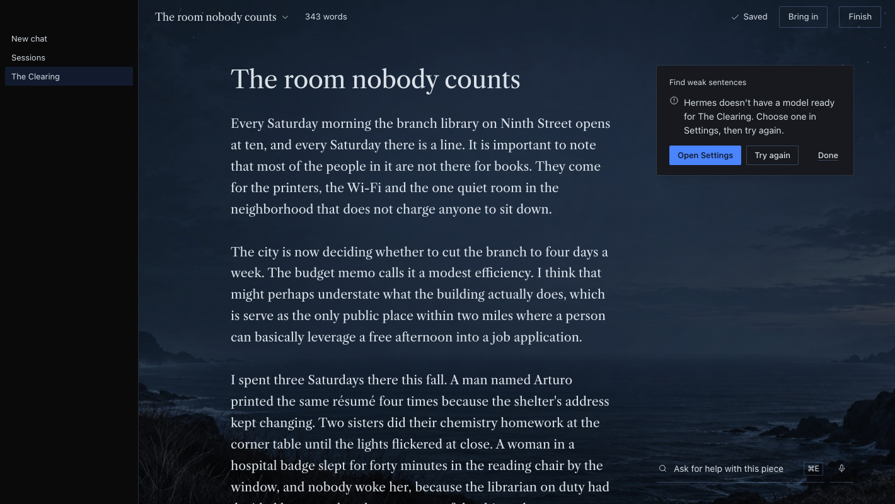 |
| 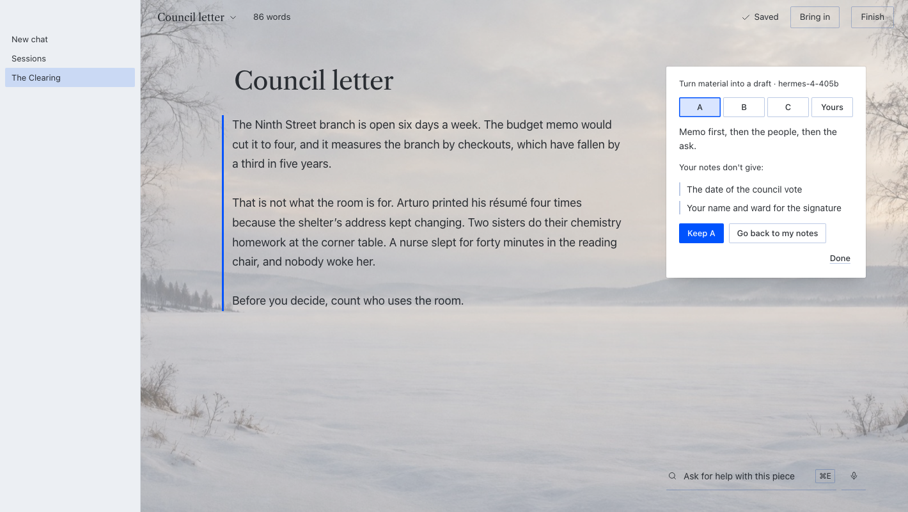 | 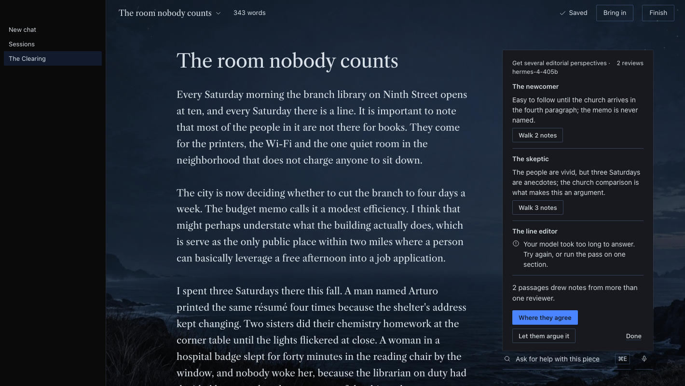 |
| 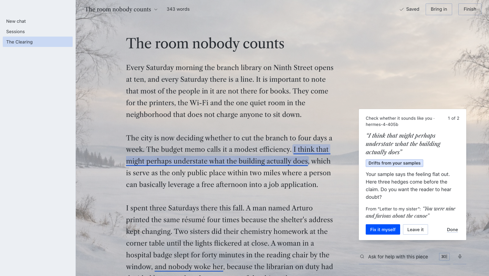 | 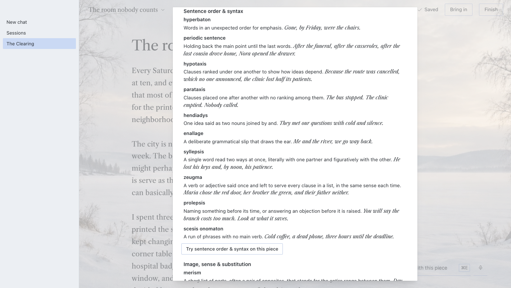 |
| 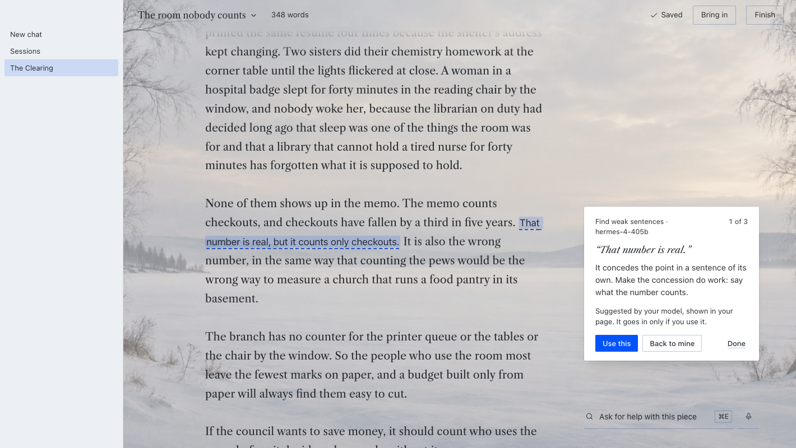 | 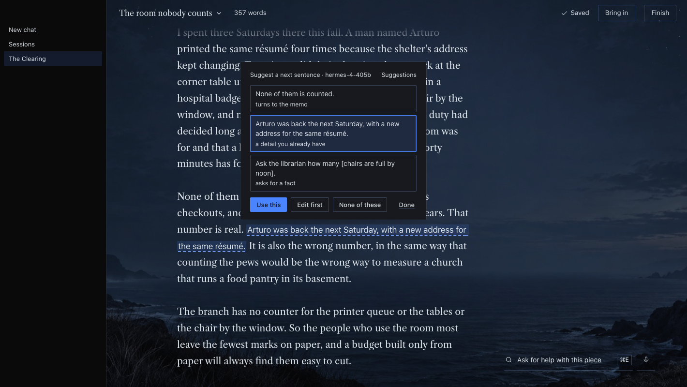 |
| 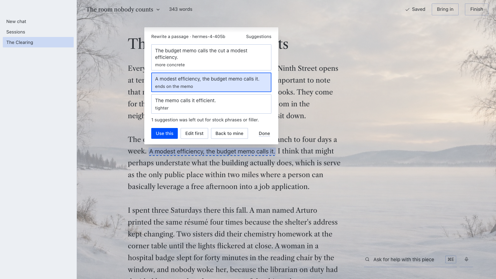 | 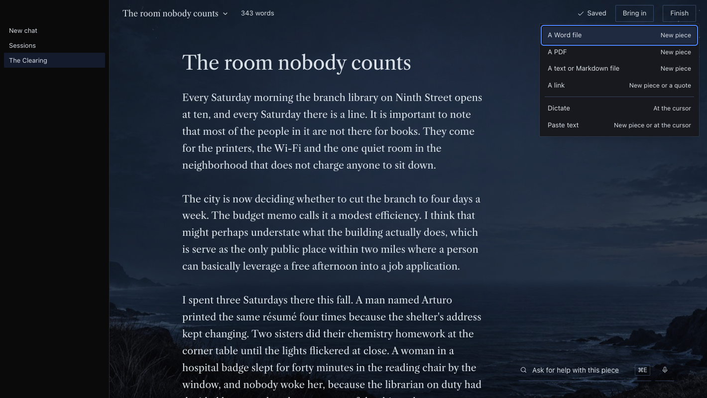 |

How to use it: [the manual](docs/MANUAL.md). What changed: [CHANGELOG](CHANGELOG.md).

## The library

The Clearing carries its whole library, in its own words:

| | Count | Runs in the room |
|---|---|---|
| Editor passes (weak sentences, hedges and filler, long and tangled sentences, out-of-place words, punctuation and typos), Propose openings, the main point and the promise three ways, Try a shorter draft and Suggest wording | 11 | 11 |
| Composition checks after Strunk (one job per paragraph, active or passive on purpose, definite and concrete, every word earns its place, varied shapes, parallel form, related words together, steady tense, weight at the end) | 9 | 9 |
| Editorial methods (find the main point, see where readers get lost, anticipate counterarguments, build earned tension, keep it moving and 28 more) | 33 | 33 |
| Craft techniques in five paths: true nonfiction (after Theodore Cheney), the human story, memorable language (rhetorical figures by effect, after Mark Forsyth), sharpening the message, and hooking an audience with a story | 56 | 56 |
| Rhetorical figures by effect, each with its own definition and example written for The Clearing | 44 | through their technique |

Every method runs. Most return the editor's read with notes pinned to your words. Eight have their own surface: **Turn material into a draft** (three drafts from your notes, tried in the page, with anything the notes lack listed apart), **Check whether it sounds like you** (against pieces you mark as voice samples, quoting the sample each judgment rests on), **Get several editorial perspectives** (three reviewers in three separate model calls, and where they agree), **Let reviewers argue it through** (the disagreement that matters, argued and answered in separate calls), **Keep a lesson for next time** and **Build your writing guidance** (rules you keep, which then go to the editor on every pass), **Set up a writing home** (your guidance and pieces as a folder of plain files, without your model), and **Find the piece across drafts** (two to five pieces read together).

Find any of them from the Ask line in plain words, or browse **All methods** in the title menu.

## Where your words go

When you run an editor pass or ask for suggested text, the piece (or the passage you selected), its title and the rules you keep in Your guidance go to the model you chose in Hermes, through Hermes's plugin model access on The Clearing's own model setting, **The Clearing editor** (Settings, Models, Auxiliary). The voice check, Build your writing guidance and a next sentence also send the pieces you marked as voice samples; Find the piece across drafts sends the pieces you choose. Hermes removes secrets from the text first. A link you bring in is read by the web tool set up in Hermes. A recording you dictate goes to the speech-to-text set up in Hermes; when that is a service on the internet, The Clearing names it and waits for you to press Send. Quick check, other words, PDFs, Word files, your own scene picture, the writing home and everything else are handled by The Clearing itself and are not sent to a model.

## Disclosures

- **Network:** The Clearing reaches the network only through Hermes. Editor passes and suggestions go through Hermes to the model you configured, only when you start one. **Bring in a link** asks Hermes's own `web_extract` tool for a public page (the plugin refuses localhost, private, link-local and other non-public addresses first; Hermes checks again when it connects); your configured web backend fetches it. **Dictate** sends the recording to Hermes's speech-to-text (`tools.voice_mode.transcribe_recording`, not in Hermes's public plugin API, imported with a guard), and to a cloud service only after you press Send for that service. The credit links on the About screen open in your browser only when you click one.
- **Microphone:** the page records with the browser's own microphone access, only after you click the microphone or Dictate, and stops when you click again (or at ten minutes). The recording is held in memory, sent once, written to The Clearing's data folder only while it is turned into text, then deleted. Nothing is kept.
- **Model use:** each pass is one model call on your own Hermes model and account, except the panel (three calls at once) and the debate (four calls, plus the panel's three when the piece has no panel yet). History shows how many passes a piece has had and about how many words the model read and wrote for them.
- **Hook:** one observe-only hook, `post_auxiliary_call`. It ignores every model call except The Clearing's own and reads only the finish reason, the model name and token counts, to catch an answer cut off at its length limit. It never reads or keeps prompt or reply text from anything else, and never changes a call.
- **Storage:** pieces, versions, editor notes, the rules you keep and what you did with the editor's suggestions (kept, skipped, chose; evidence for lessons) are kept in `<HERMES_HOME>/plugin-data/clearing/clearing.db`. Set up a writing home writes plain files into `<HERMES_HOME>/plugin-data/clearing/home/`, never over a file already there. Preferences and a buffer of words not yet saved are kept in Hermes's desktop plugin storage.
- **Files:** The Clearing reads only files you pick and writes text exports only into a folder you grant. Word files are built in `<HERMES_HOME>/plugin-data/clearing/exports/` and handed to Hermes's save dialog. PDFs are read with the standard library, with caps on size, objects, inflation, pages and time. Your own scene picture (JPEG, PNG or WebP, 6 MB at most, checked by its bytes) is kept in `<HERMES_HOME>/plugin-data/clearing/scene/` until you remove it.
- **Deleting:** nothing is deleted outright. Trash is a flag you can undo. Past 200 versions of one piece, the oldest pause-saves roll off.
- **Suggested text:** shown only when you ask, put into the page only on your click, and recorded (what it replaced, what went in, which model) for History. Off in The room, the backend refuses it too.
- **Not used:** no camera, tools of its own, shell commands, background work, credentials, telemetry or self-updates.
- **Images:** the three scene photographs (Snow Light, Quiet Marsh, Night Tide) were generated for The Clearing's web app.

## Install

Needs Hermes 0.22.6 or later (it uses `ctx.files`). Tested on macOS; Windows and Linux are untested, not unsupported.

1. Install it: `hermes plugins install clearing` once it is in the catalog, or `hermes plugins install Dgardenhire/hermes-clearing` from this repository.
2. Turn it on when asked (or later in Settings, Plugins). The Clearing appears in the sidebar; the sample piece opens the first time.
3. Optional: in Settings, Models, Auxiliary, point **The Clearing editor** at the model you want for editor passes. Without a choice it uses your main model.

The Clearing has no settings of its own and asks for no keys.

## Credits

The named editorial methods come from [Compound Writing](https://github.com/EveryInc/compound-writing) by Every (Katie Parrott). The Clearing's instructions, checks and workflows are written independently, no Compound Writing file is included, and The Clearing is not affiliated with or endorsed by Every. The craft techniques are informed by the books listed in the app's About screen; none of their text is reproduced. Libre Caslon Text is used under the SIL Open Font License 1.1 (`desktop/assets/Libre-Caslon-Text-OFL.txt`). Better words uses Open English WordNet 2025 (CC BY 4.0, by the Open English WordNet team) and WordNet 3.1 (Copyright 2011 Princeton University, under the WordNet license); the full notice is in `library/thesaurus/NOTICE.txt`.

## Development

- Tests: `cd tests && /usr/bin/python3 -m unittest` (Python, plus the page's JavaScript through `node --test`).
- Desktop bundle: `node <hermes-ui-kit>/scripts/build.mjs .` from this folder, with a checkout of hermes-ui-kit (add `--check` to confirm the committed bundle is current). Assets: `/usr/bin/python3 scripts/embed_assets.py`.
- Library: `node scripts/port_library.mjs` re-ports the methods and craft paths from the web app; `/usr/bin/python3 scripts/overlap_check.py --source <upstream folder>` checks that no 12-word run of shipped text appears in a source; set `CLEARING_UPSTREAM` to that folder and the test suite runs the same check. Before a release, `scripts/release-check.sh` runs it and fails if the variable is missing ([docs/RELEASE.md](docs/RELEASE.md)).
- Screens: serve the repo (`/usr/bin/python3 -m http.server 8794 --bind 127.0.0.1 --directory .`) and run `harness/shoot.sh` (set `PORT` if 8794 is taken).
- Live test and demo: `docs/LIVE-TEST.md` and `docs/DEMO-NOTES.md`.
- Catalog entry: `/usr/bin/python3 scripts/pin_catalog.py` writes the current commit, the card image and the screenshot URLs into `docs/catalog/clearing.yaml` (a draft; the PR text is `docs/catalog/PR.md`). The card renders from `harness/card.html` with `harness/shoot.sh card`.

## License

The Clearing's own code and text are under the [PolyForm Shield License 1.0.0](LICENSE) (Required Notice: Copyright (c) 2026 Damon Gardenhire). In plain English: it is free to use, including for paid writing work; you may not use this code to offer a competing product. The desktop bundle includes hermes-ui-kit, the author's own code, under the same license. The fonts, the WordNet data and the other third-party material listed under Credits keep their own licenses. All of this is in [NOTICE](NOTICE).
