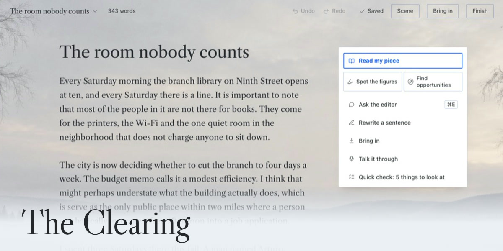

<!-- DRAFT. Not opened. Title: feat(plugin-catalog): add clearing (The Clearing, a writing page for Hermes Desktop)
     Before opening: pick the release commit, replace SHA_PLACEHOLDER in docs/catalog/clearing.yaml and below with it,
     and copy the file to plugin-catalog/clearing.yaml in a hermes-agent branch. -->

## What does this PR do?

Adds `plugin-catalog/clearing.yaml`: **The Clearing**, a page for writing inside Hermes Desktop.

You write in one page. When you ask for help, your own Hermes model marks exact passages in your piece, each note names one change and why, and **Show me** draws the change into the page with your words struck through. Nothing goes in until you click **Use this**; **Undo** takes it back out, and History records which suggestions were used and which model wrote them.

What it contains:

- **Built in, no model:** Quick check (throat-clearing, stock openings, stacked hedges, filler, stock phrases, long sentences) and Other words, a dictionary from Open English WordNet.
- **On the user's own Hermes model:** Read my piece (up to five changes, the strongest line, the one passage to cut first), Find figures of speech, Where to add a technique, one-sentence Rewrite, Tighten and Make it concrete, an Ask line (Cmd E / Ctrl E) that finds the right pass from plain words, and a library of 11 editor passes, 9 composition checks, 33 editorial methods and 56 craft techniques in five paths, plus 44 figures of speech.
- **Bring in** a Word file, PDF, text or Markdown file, public web page, pasted text or dictation, and **Finish** to Markdown, plain text or Word.
- **Safeguards:** every quote the model returns is checked against the text before it is shown, and a note that does not match is dropped. A cut-off answer is caught with the finish reason from `post_auxiliary_call` plus a token ceiling and a parse check, so a half answer never lands. With **Suggested text: Off** the editor points and asks but drafts no words, and the backend refuses suggestion requests.

## Hermes surfaces used

- Agent plugin (`__init__.py`): `ctx.register_auxiliary_task("clearing_editor")` (the model setting), `ctx.register_hook("post_auxiliary_call")`, and `ctx.dispatch_tool` for Hermes's `web_extract`.
- Dashboard backend (`dashboard/plugin_api.py`), with model calls through `agent.plugin_llm.PluginLlm` and secrets removed with `agent.redact` first (the call is refused if that is unavailable), and one `pass.ended` event to its own page through `hermes_cli.plugin_events`.
- Desktop plugin (`desktop/plugin.js`): a sidebar route, command-palette entries (Open The Clearing, Quick check this piece, Ask the editor), `api.files` for the save and folder dialogs, `api.os.openExternal` to open the manual in the user's browser, and plugin storage for preferences.

## Type of change

New catalog entry (community tier).

## Changes made

- `plugin-catalog/clearing.yaml` (one new file), pinned to `Dgardenhire/hermes-clearing@SHA_PLACEHOLDER`, `version: "0.1.0"`, `requires_hermes: ">=0.21.6"`, the same floor as its `plugin.yaml`. The one newer feature it uses, the desktop file store (0.22.6), is checked before use: on 0.21.6 to 0.22.5, Save as .md and .txt offer Copy instead.

## Disclosures (catalog rule 13)

- **Network calls to third-party services:** none of its own, and no LINCHPIN server. Editor passes go through Hermes's plugin model access to the user's configured model, on the plugin's own auxiliary task `clearing_editor` (Settings, Model, Auxiliary models), only when the user starts one. The piece or selected passage, its title and the user's kept rules are sent, with secrets removed by Hermes's redaction first. **Bring in a link** dispatches Hermes's own `web_extract`; before that the plugin refuses non-http(s) addresses and any host that resolves to a localhost, private or link-local address, using a DNS lookup of the host. **Talk it through** sends the recording to the speech-to-text set up in Hermes, and for a cloud service (OpenAI, Groq, Mistral, xAI, ElevenLabs, DeepInfra) or a run-time choice by Hermes it names the service and waits for the user to press Send for that service.
- **Reads outside its own data:** files the user picks; Hermes's `stt` configuration, read-only, via `hermes_cli.config.load_config_readonly`; and the shared Hugging Face model cache (`HF_HUB_CACHE`, `HF_HOME`, `XDG_CACHE_HOME` or `~/.cache/huggingface/hub`), read-only, to find a faster-whisper model already downloaded. It never downloads one, and uses it only when Hermes's speech-to-text is unavailable or fails. On that path it sets `KMP_DUPLICATE_LIB_OK=TRUE` in the process environment.
- **Shell commands:** none.
- **Background processes:** none. No scheduled work and no self-updates. The page checks in with its own backend only while it waits: once a second while a pass the user started is running (the `pass.ended` event usually answers first), and every five seconds while the backend is unreachable. Both stop on their own. At start-up, passes left "running" by a restart are marked failed.
- **Stored credentials:** none. No `requires_env`, no keys, no reading of Hermes's credential stores.
- **Telemetry:** none.
- **Microphone:** in-page `getUserMedia`, only after the user clicks the microphone or Talk it through. The recording is held in memory, sent once, written to `<HERMES_HOME>/plugin-data/clearing/` only while it is transcribed, then deleted. Ten minutes and 25 MB at most.
- **Hook:** one observe-only `post_auxiliary_call` hook. It ignores every task but `clearing_editor` and reads only the finish reason, model name and token counts, kept in memory to catch cut-off answers. It never reads prompt or reply text and never changes a call.
- **Storage:** pieces, versions, editor notes, kept rules, kept or skipped suggestions and, per pass, the model name, provider, token counts and finish reason, in `<HERMES_HOME>/plugin-data/clearing/clearing.db`. A writing home (optional, user-triggered) writes plain files into `<HERMES_HOME>/plugin-data/clearing/home/` and never over an existing file. Preferences and an unsaved-text buffer go to desktop plugin storage. When a pass fails, one line goes to `<HERMES_HOME>/plugin-data/clearing/debug.log` (written by `gateway.trace`): the time, the error type and an excerpt of the message with anything quoted removed, never the writer's words; it keeps the last 200 lines.
- **Files:** reads only files the user picks; writes text exports only into a folder the user grants; builds Word exports in `<HERMES_HOME>/plugin-data/clearing/exports/` for Hermes's save dialog. PDFs are read with the standard library (12 MB at most, with caps on objects, inflation, pages and time). A user's own scene picture (JPEG, PNG or WebP, 6 MB at most) stays in `<HERMES_HOME>/plugin-data/clearing/scene/` until removed.
- **Deleting:** Move to trash is a flag the user can undo. In the Trash, **Delete forever** and **Empty the trash** ask first, then remove the piece, its versions, pass records and kept or skipped suggestions from `clearing.db` with SQLite's secure delete on, and truncate the write-ahead log. Only a piece already in the trash can be deleted. Past 200 versions of one piece, the oldest pause-saves are dropped.
- **Suggested text:** drafted only on request, inserted only on a click, recorded with the model's name; a room setting turns it off and the backend refuses it then.
- **License:** the plugin's own code is under the PolyForm Shield License 1.0.0 (`PolyForm-Shield-1.0.0`): free to use, including for paid writing work; not for offering a competing product. It is source-available, not OSI open source.
- **Bundled code:** `desktop/plugin.js` includes hermes-ui-kit, the author's own code, under the same license (`NOTICE`).
- **Third-party data bundled:** Libre Caslon Text (SIL OFL 1.1); Open English WordNet 2025 (CC BY 4.0) and WordNet 3.1 (Princeton license), with the notice in `library/thesaurus/NOTICE.txt`.
- **Credits:** the named editorial methods come from Compound Writing by Every (Katie Parrott). The Clearing's instructions are written independently, no Compound Writing file is included, and a 12-word overlap check runs before each release. Not affiliated with or endorsed by Every.

## Validator warning

`hermes plugins validate` passes every check and raises one warning:

- `private core imports: dictation.py:70 tools.voice_mode.transcribe_recording`: this is the function behind Hermes's own dictation, which is not in the public plugin API. The import sits in a `try`, so a Hermes that moves it makes the plugin fall back to faster-whisper on the user's computer when a speech model is already downloaded, and otherwise show "Dictation needs speech-to-text" while everything else keeps working.

## How to test

1. `hermes plugins install clearing` and turn it on. The Clearing appears in the sidebar and opens a sample piece with a welcome card.
2. Click **Try it on the sample**: a read made ahead of time opens in the margin, labeled as such. Open the first change, click **Show me**, then **Use this**, then **Undo**.
3. In the desk, click **Quick check**: notes appear without a model call.
4. Double-click a word in the page: senses and other words from the local dictionary. Click one to swap it in; **Go back to** restores the original.
5. Press Cmd E (Ctrl E), type "where do readers get lost" and press Enter. A note from your model appears, naming the model.
6. With no model set up in Hermes, run any pass: "Hermes doesn't have a model ready for The Clearing" with **Open Settings**, and the page unchanged.

7. Move a piece to the trash, open Trash from the title menu, click **Delete forever** and confirm: the piece is gone from the Trash and from `clearing.db`.

The plugin's own suite is under `tests/`: 217 Python tests (`cd tests && python -m unittest discover -s . -p 'test_*.py'`, 1 skipped: the upstream overlap check, which needs a local Compound Writing copy) and 108 JavaScript tests (`node --test tests/js/*.test.mjs`, 107 pass, 1 skipped), all passing on the pinned commit.

## Changes since the first draft of this PR (Nov 10-11)

- Read my piece on Claude models: when Claude's strict mode rejects the answer format, the plugin falls back to a plain request and reads the JSON from the reply (it used to fail after about 99 s). Checked live on Haiku: 26 s.
- `requires_hermes` lowered from `>=0.22.6` to `>=0.21.6` in `plugin.yaml` and this entry.
- The page draws the last piece at once while the backend starts; the scene photographs moved out of the bundle (`desktop/plugin.js` about 650 KB, from 1.6 MB) and come from the plugin's own route.
- Delete forever and Empty the trash, with a confirm.
- Contrast: main buttons now pick white or black text from the fill's luminance (dark-theme buttons measured 3.58:1 before); page marks over the scene photographs clear 4.5:1; a visible focus rule beside the page.
- README: Uninstall, `debug.log`, and the page's waiting checks disclosed.
- Read my piece keeps a praise sentence whole; it had cut one at its first comma ("The piece has a strong.").
- A finished plain-JSON answer past the token ceiling is kept: on Haiku, whose thinking counts as output, Find figures of speech had refused a whole answer as cut off.
- **The manual** in the title menu opens the manual on linchpin.studio in the user's browser.

## Checklist

- [x] One file, only this entry
- [x] `requires_hermes` matches `plugin.yaml` and is not newer than the current release
- [ ] Pinned 40-character sha; `version` matches the pinned code (at publish: `scripts/pin_catalog.py`)
- [ ] Image and screenshots on `raw.githubusercontent.com`, pinned to the same sha (at publish)
- [x] Disclosures above and in the plugin's README
- [x] Tested on macOS. Windows and Linux are untested (listed in `known_issues`)
- [x] `tier: community`

## Screenshots

The catalog card:

The entry lists five screenshots (`docs/shots/desk.jpg`, `selection-bar.jpg`, `spot-the-figures.jpg`, `find-opportunities.jpg`, `opportunity-show.jpg`), all of the sample piece, "The room nobody counts", which ships with the plugin.
